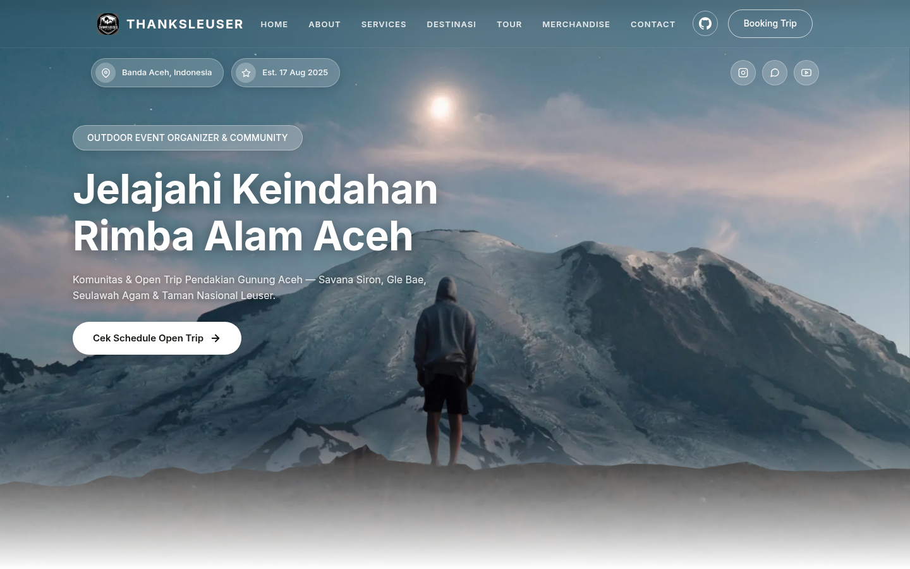
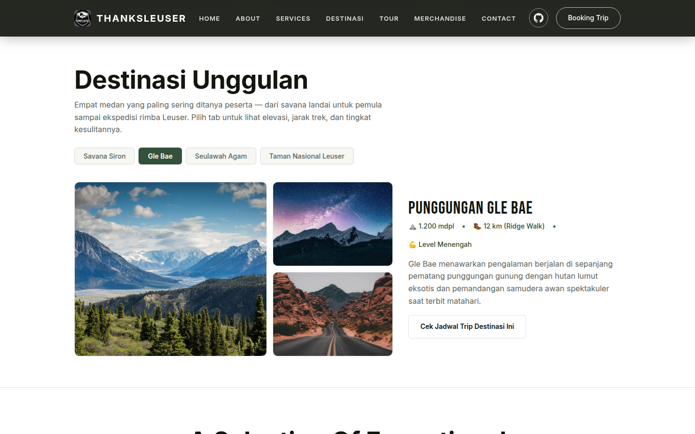
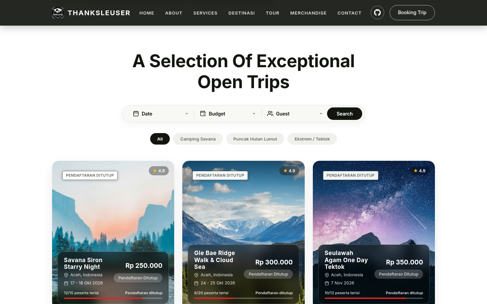
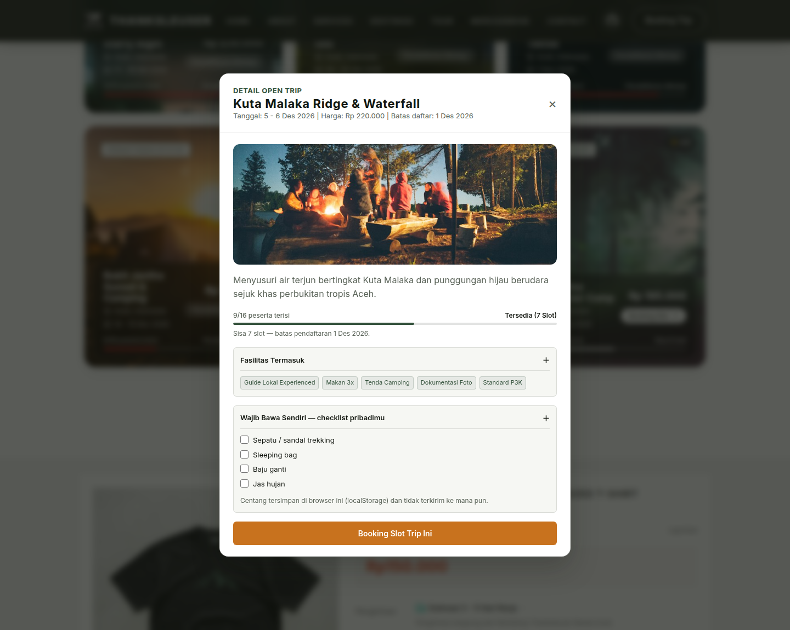
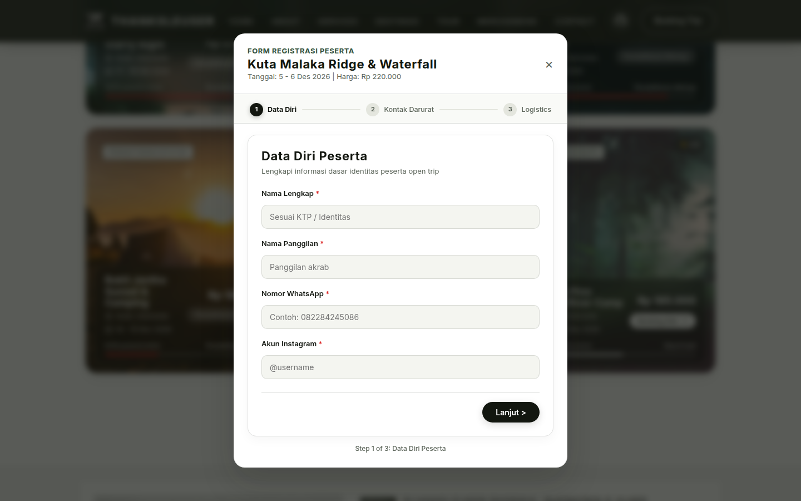
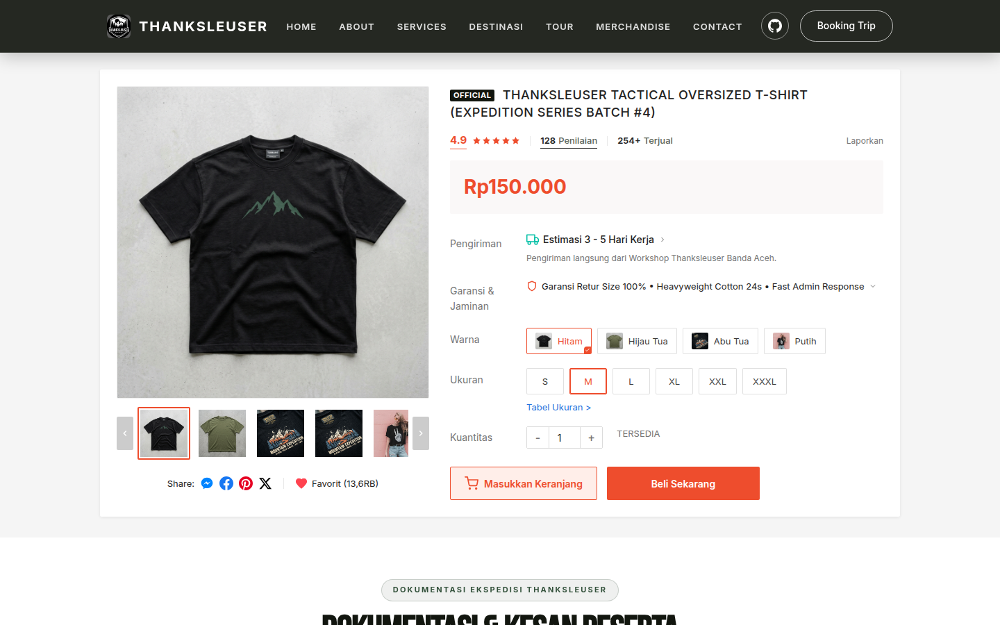

# Thanksleuser

**Outdoor Event Organizer & Community Banda Aceh** — landing page + booking
engine open trip pendakian dan camping di Aceh. Satu halaman statis, tanpa
backend: daftar trip dengan status kuota real-time (dihitung dari tanggal dan
kuota), filter, modal detail trip + checklist perlengkapan, wizard booking
3 langkah yang mengirim form sebagai pesan WhatsApp ke admin, dan pre-order
merchandise.

> **Live:** https://thanksleuser.pages.dev ·
> **Repo:** https://github.com/dezzorigin/thanksleuser



## Video demo

[docs/demo/demo.mp4](docs/demo/demo.mp4) (40 detik: hero → destinasi → trip →
detail + checklist → wizard booking → merchandise → galeri → footer).
Direkam dari situs yang sedang berjalan (bukan mockup) — lihat
[docs/DEMO.md](docs/DEMO.md) untuk cara merekam ulang.

## Screenshot

| Hero | Destinasi | Daftar trip |
|---|---|---|
|  |  |  |

| Detail trip + checklist | Wizard booking | Merchandise |
|---|---|---|
|  |  |  |

## Fitur

- **Daftar trip (15 trip, `data/trips.json`)** — kartu menampilkan foto,
  tanggal keberangkatan, harga, badge status, dan progress bar kuota.
  Status dihitung otomatis: Tersedia / Hampir Penuh (sisa < 30%) / Sold Out /
  Pendaftaran Ditutup (lewat batas pendaftaran).
- **Filter** — tanggal (Bulan Ini / Bulan Depan), budget, tingkat kesulitan,
  dan pill kategori (Camping Savana / Puncak Hutan Lumut / Ekstrem-Tektok).
  Semua bekerja tanpa reload; trip yang tidak cocok menampilkan pesan kosong.
- **Modal detail trip** — foto, tanggal, harga, batas pendaftaran, kuota,
  fasilitas termasuk, dan checklist **"Wajib Bawa Sendiri"** yang tersimpan di
  `localStorage` browser (pengingat pribadi, tidak terkirim ke mana pun).
- **Wizard booking 3 langkah** — data diri → data safety & kontak darurat →
  kaos & sewa alat, dengan validasi tiap langkah. Submit membuka WhatsApp ke
  admin (0822-8424-5086) dengan pesan terformat + total tagihan.
- **Section destinasi** — 4 tab (Savana Siron, Gle Bae, Seulawah Agam, Taman
  Nasional Leuser) dengan elevasi, jarak trek, tingkat kesulitan, dan foto.
- **Merchandise** — PDP ala Shopee: galeri foto, pilih warna/ukuran/jumlah,
  size chart, order via WhatsApp (Rp150.000/pcs).
- **Galeri & testimoni** — galeri parallax 3D + marquee testimoni peserta,
  lightbox per foto.
- **Hero parallax** — 4 layer (GSAP + Lenis) dengan degradasi aman: kalau CDN
  mati, hero tetap tampil statis.

## Tech stack

- HTML5 + CSS3 vanilla (custom properties, grid, flexbox) + JavaScript
  vanilla — **tanpa framework, tanpa build step**.
- Data trip di `data/trips.json` (di-fetch dan dirender JS).
- GSAP + ScrollTrigger dan Lenis via CDN (progresif, ada guard bila gagal
  dimuat). Foto dari Unsplash + `cdn.21st.dev`.
- Deploy: Cloudflare Pages (proyek `thanksleuser`).

## Cara menjalankan

```bash
# Tanpa install apa pun (situs statis murni):
python3 -m http.server 8329
# buka http://127.0.0.1:8329

# Atau dengan Node (server kecil di scripts/serve.mjs):
npm install
npm run dev        # http://127.0.0.1:8329
```

> Jangan dibuka lewat `file://` — `fetch('data/trips.json')` diblokir
> browser dari protokol file, daftar trip tidak akan tampil.

## Menambah / mengubah trip

Edit `data/trips.json` (satu objek per trip: `id` unik, `nama`,
`tanggalMulai`, `tanggalSelesai`, `harga`, `kuotaTotal`, `kuotaTerisi`,
`batasPendaftaran`, `kategori`, `tingkatKesulitan`, `fasilitasTermasuk`,
`wajibBawaSendiri`, `foto`, `deskripsi`). Lalu validasi:

```bash
node scripts/check-links.mjs   # memvalidasi skema + semua aturan tanggal/kuota
```

Panduan lengkap admin ada di [docs/USER-GUIDE.md](docs/USER-GUIDE.md).

## Tes & CI

```bash
npm run validate   # check-links (referensi, skema trips, sapu secret) + html-validate
npm run sweep      # advisory sweep OSV batch (dependensi produksi; repo ini 0)
npm test           # Playwright e2e — 10 tes alur produk penuh
npm run screenshots  # 8 screenshot dokumentasi (butuh Chromium di cache)
npm run make-video   # rangkai screenshot jadi docs/demo/demo.mp4 (butuh ffmpeg)
```

CI (`.github/workflows/ci.yml`, 3 job): `static-checks` (check-links +
html-validate + smoke server), `advisory-sweep` (OSV batch, tanpa auth —
pola repo P1 #24–#28; jangan ganti ke GitHub Advisory API + token),
`playwright-e2e`.

## Struktur proyek

```
index.html              Satu halaman: hero, about, services, destinasi, trips,
                        merchandise, dokumentasi, alur, footer + 4 modal
style.css               Seluruh styling (token desain v2)
script.js               Seluruh logika (render trip, filter, wizard, merch,
                        destinasi, galeri, parallax)
data/trips.json         15 trip — satu-satunya data
images/                 Foto produk merch (lokal)
public/                 Ikon SVG
scripts/                serve.mjs, check-links.mjs, advisory-sweep.py,
                        screenshot.mjs, make-video.mjs
e2e/                    Playwright smoke test
docs/                   PRD, arsitektur, panduan, deployment, demo, diagram
docs/specs/             design.md + 2 spec asli proyek
wrangler.toml           Konfigurasi Cloudflare Pages
```

## Dokumentasi

- [PRD](docs/PRD.md) — requirement fungsional + catatan implementasi v1.1.0
- [Arsitektur](docs/ARCHITECTURE.md) — peta file, alur data, status trip,
  dependensi eksternal, keamanan
- [Panduan Pengguna](docs/USER-GUIDE.md) — untuk peserta dan admin
- [Deployment](docs/DEPLOYMENT.md) — cara deploy ulang ke Cloudflare Pages
- [Demo](docs/DEMO.md) — video + screenshot + cara merekam ulang
- [Diagram](docs/DIAGRAMS.html) — arsitektur, alur booking, status trip,
  struktur halaman (HTML+SVG)
- [Spesifikasi desain](docs/specs/design.md) dan
  [spec-01](docs/specs/thanksleuser-spec-01.md) /
  [spec-02](docs/specs/thanksleuser-spec-02.md) (dokumen asli proyek)

## Lisensi

MIT — lihat [LICENSE](./LICENSE).

---
_Dikembangkan oleh **dezzorigin** (Nabil Aulia Dika)._
