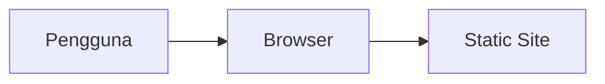

# Thanksleuser

Thanksleuser — project oleh Nabil Aulia Dika (dezzorigin).

## Status Proyek

**Dalam pengembangan** _(README ada)_

## 📋 Tech Stack

Node.js

## 🏗️ Arsitektur



## 📁 Struktur Proyek

```
.wrangler/
data/
images/
public/
LICENSE
PRD.md
README.md
design.md
favicon.ico
icon.png
index.html
package.json
prd.md
script.js
skills_output.txt
style.css
thanksleuser-spec-01.md
thanksleuser-spec-02.md
wrangler.toml
```

## 🚀 Getting Started

```bash
# Install dependencies
npm install

# Jalankan development server
npm run dev
```

> Untuk project HTML/Python/Go, lihat instruksi di atas atau file konfigurasi.

## 📄 Lisensi

MIT — lihat [LICENSE](./LICENSE).

---
_Dikembangkan oleh **dezzorigin** (Nabil Aulia Dika)._
